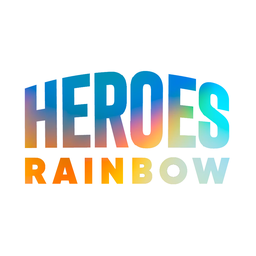

<p align="center">
  
</p>

<h1 align="center">Heroes Rainbow 🌈</h1>

<p align="center">
  iOS catalog app of <b>Rainbow</b>, the Heroes design system, built on top of the <a href="https://github.com/guikbsx/rainbow_fwk">RainbowFWK</a> framework.
</p>

Heroes Rainbow showcases every component of the [RainbowFWK](https://github.com/guikbsx/rainbow_fwk) design system framework in a single SwiftUI app, to browse and try them on a simulator or a device.

## Features

The home screen groups the design system into four sections, each entry opening a demo screen:

- **Components**: Autocomplete, Avatar, Badge, Banner, Bottom Bar, Button, Card, Chat List, Comment, Divider, Input, Item Action, Item Chat, Item Naming, Item Videos, Loader, Message, Notification, Radio, Snack Bar, Subtitle, Tabs, The Voice, Top Bar
- **Organism**: Header Profile, Success Page
- **Foundations**: Emojis, Layout, Elevations & Shadow
- **Brand**: Colors, Typography

## Requirements

- Xcode with Swift 5 (Kingfisher is pinned to its `version6-xcode13` branch, i.e. Xcode 13)
- iOS 13.0 deployment target; the catalog itself needs **iOS 14** or later
- [CocoaPods](https://cocoapods.org) (the lockfile was generated with 1.10.1)
- A local clone of [rainbow_fwk](https://github.com/guikbsx/rainbow_fwk) next to this repository

## Installation

The `Podfile` references the framework through a local path (`pod 'RainbowFWK', :path => '../rainbow_fwk'`), so both repositories must live in the same folder:

```bash
git clone https://github.com/guikbsx/rainbow_fwk.git
git clone https://github.com/guikbsx/heroes_rainbow.git
cd heroes_rainbow
pod install
open heroes_rainbow.xcworkspace
```

Then select the `heroes_rainbow` scheme and run it on a simulator or a device.

## Project structure

```
heroes_rainbow/
├── Ressources/        # AppDelegate, SceneDelegate (loads the RainbowFWK fonts), app info, R.swift resources
├── Views/
│   ├── HomeView.swift # Catalog home screen
│   ├── Components/    # One demo screen per component
│   ├── Organism/      # Organism demos
│   ├── Foundations/   # Emojis, layout, elevations
│   └── Brand/         # Colors, typography
├── Components/        # Building blocks of the catalog (grid, category, pickers…)
└── Assets.xcassets    # App icon and images
```

Main dependencies (see `Podfile`): RainbowFWK, R.swift, Kingfisher, lottie-ios.

## Version

1.0.0 (build 13). Release notes are in [`heroes_rainbow/README.md`](heroes_rainbow/README.md).

❤️ Coded with love
